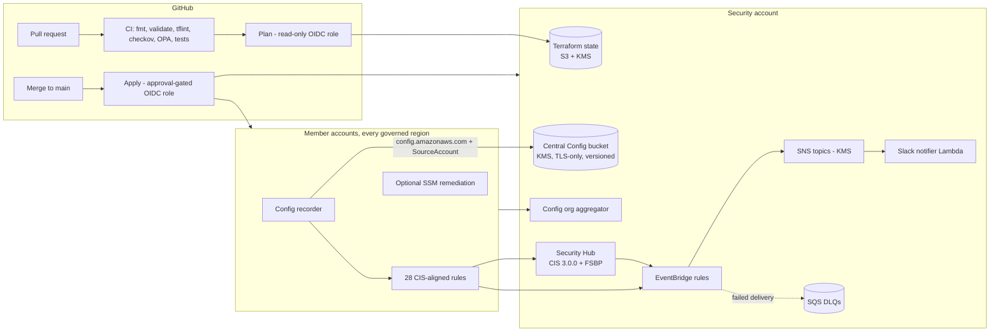

# Architecture

## Account model

## Key design decisions

| Decision | Rationale |
|---|---|
| Separate **plan** and **apply** IAM roles | PRs (including less-trusted branches) can only read. Apply is reachable only from a GitHub Environment with required reviewers. |
| Apply role scoped to `<name_prefix>-*` | Limits blast radius. It can attach only an allow-list of policy ARNs, so it cannot grant itself admin. |
| Explicit Deny guardrails | CI cannot modify its own roles/OIDC provider, the state bucket's security settings, or bootstrap keys. |
| One stack instance per account **and region** | Config, Security Hub, SNS and KMS are regional. Separate state keys keep blast radius to one region. |
| `is_home_region` flag | IAM and CloudTrail are global. Recording and evaluating them in every region creates duplicates and cost. |
| Central bucket uses service-principal delivery + `aws:SourceAccount` | The AWS-documented cross-account pattern, protected against confused-deputy. |
| Slack webhook in Secrets Manager | Terraform state and Lambda configuration never contain the URL. The Lambda also validates the host is `hooks.slack.com`. |
| Remediation is `automatic = false` by default | Detect -> manual -> automatic progression; automatic runs are bounded (retries, concurrency, error %). |
| S3 native state locking (`use_lockfile`) | No DynamoDB table to operate; supported since Terraform 1.10. |
| OPA on plan JSON | Catches mistakes (public SG rules, unencrypted resources, wildcard IAM) before apply, independent of provider linters. |

## Data flow for an alert

1. A Config rule turns `NON_COMPLIANT` (or Security Hub imports a HIGH/CRITICAL, failed, new finding).
2. EventBridge matches the pattern, transforms the event, and publishes to a KMS-encrypted SNS topic. Undeliverable events go to a KMS-encrypted SQS DLQ after 8 retries / 1 hour.
3. SNS fans out to confirmed email subscribers and the Slack Lambda.
4. The Lambda fetches the webhook from Secrets Manager (cached), posts to Slack with a 10 s timeout, and raises on failure so Lambda's async retry and its own DLQ capture the alert.

## Environments

`environment` is one of `dev | staging | prod` and is used for tagging. For real isolation, deploy dev/staging/prod into **separate AWS accounts** with their own bootstrap and state bucket; do not share one account across environments.
